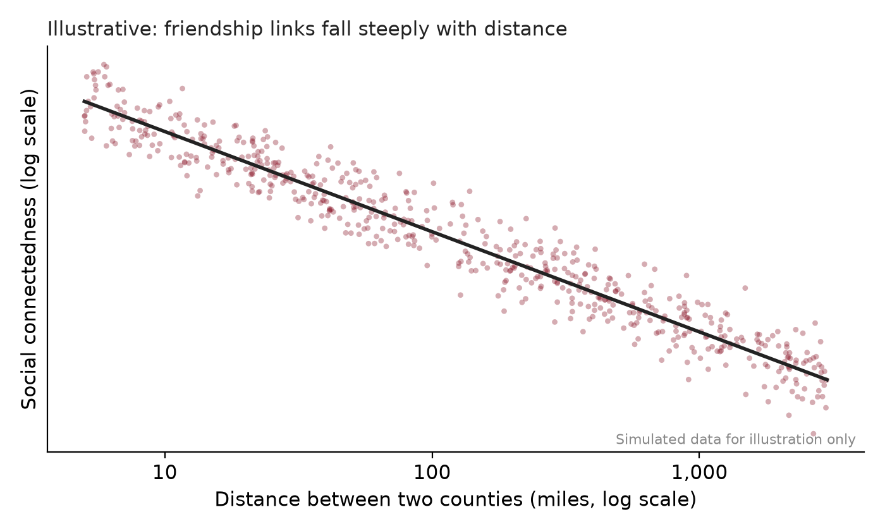

::: {.callout-note appearance="simple"}
**Read:** Brueckner, Chapter 1; @glaeser1998; @glaeser2009wealth; @bailey2018social.
:::

## The model

Rent for a one-bedroom apartment in Boston is far higher than in rural Maine. Commutes are longer, streets are louder, and parking is scarce. Yet roughly four in five Americans live in urban areas. Why do so many people pay more to live close to one another? Because being close to other people and firms makes us more productive and gives us access to things we value.

### Why not spread out?

In a world where everyone could produce what they need on their own plot, with no advantage to working at scale, there would be no reason to live near anyone, and land would be cheap everywhere. Cities appear because of two forces:

- **Scale economies.** Some goods are much cheaper to make in large plants or offices, so production concentrates in a few places and workers live nearby.
- **Transport costs.** Moving goods, people, and ideas takes money and time, so it pays to locate near customers, suppliers, ports, and rivers.

### Agglomeration economies

Once a city exists, firms become more productive simply because other firms and workers are nearby. These **agglomeration economies** work through three channels [@duranton2004]:

- **Sharing:** firms share suppliers, infrastructure, and a large pool of workers.
- **Matching:** a big labor market makes it easier to fit the right worker to each job.
- **Learning:** ideas spread faster when people meet face to face.

**Localization economies** come from many firms in the *same* industry clustering together; **urbanization economies** come from the size and variety of the whole city.

### Spatial equilibrium across cities

If big cities make workers more productive, why doesn't everyone move to the highest-wage city? Because moving bids the advantage away. A worker in city $i$ earns wage $w_i$, pays rent $r_i$, and enjoys amenities worth $a_i$:

$$
V_i = w_i - r_i + a_i = \bar{V} \quad \text{for every city } i.
$$

With free mobility, utility is the same everywhere for the marginal mover [@roback1982; @glaeser2009wealth]. High wages *with* high rents signal a **productive** city; high rents with *low* wages signal valuable **amenities**.

### How big does a city get?

Agglomeration benefits grow with population, but so do congestion and housing costs. So utility per resident first rises with population, peaks at some size $N^*$, and then falls. People move in as long as the city beats the utility $\bar{u}$ they could get elsewhere. The simulation shows where that leaves the city.

## Simulation

Utility per resident is $u(N) = 20 + aN - cN^2$, where $a$ measures agglomeration benefits and $c$ congestion costs. Population $N$ is in hundreds of thousands.

::: {.sim}
```{ojs}
//| echo: false
viewof aggl = Inputs.range([2, 14], {value: 8, step: 0.5, label: "Agglomeration benefit, a"})
viewof cong = Inputs.range([0.3, 2], {value: 0.8, step: 0.05, label: "Congestion cost, c"})
viewof ubar = Inputs.range([10, 50], {value: 30, step: 0.5, label: "Utility available elsewhere, ū"})
```

```{ojs}
//| code-fold: true
u = n => 20 + aggl * n - cong * n * n
Nstar = aggl / (2 * cong)                         // size that maximizes utility per resident
disc = aggl * aggl + 4 * cong * (20 - ubar)       // u(N) = ubar is a quadratic in N
roots = disc >= 0 ? [(aggl - Math.sqrt(disc)) / (2 * cong), (aggl + Math.sqrt(disc)) / (2 * cong)] : []
stable = roots.length ? roots[1] : NaN
unstable = roots.length ? Math.max(roots[0], 0) : NaN
Nmax = Math.max(aggl / cong, 2) * 1.05
Plot.plot({
  height: 340, marginLeft: 50,
  x: {label: "City population, N (hundred thousand) →", domain: [0, Nmax]},
  y: {label: "↑ Utility per resident", grid: true},
  marks: [
    Plot.line(d3.range(0, Nmax, Nmax / 200), {x: d => d, y: u, stroke: "#881124", strokeWidth: 3}),
    Plot.ruleY([ubar], {stroke: "#888", strokeDasharray: "5,4"}),
    Plot.dot([{n: Nstar, v: u(Nstar)}], {x: "n", y: "v", r: 5, fill: "black"}),
    Plot.text([{n: Nstar, v: u(Nstar)}], {x: "n", y: "v", text: () => "N*", dy: -12}),
    roots.length ? Plot.dot([{n: stable, v: ubar}], {x: "n", y: "v", r: 6, fill: "#881124"}) : null,
    roots.length ? Plot.text([{n: stable, v: ubar}], {x: "n", y: "v", text: () => "stable", dy: 16}) : null,
    roots.length && roots[0] > 0 ? Plot.dot([{n: unstable, v: ubar}], {x: "n", y: "v", r: 5, fill: "#888"}) : null
  ]
})
```

```{ojs}
//| echo: false
html`${roots.length ? "" : html`<p><strong>No city forms:</strong> even at its best size, the city cannot beat the utility available elsewhere.</p>`}
<table class="table table-sm readout"><tbody>
  <tr><td>Size that maximizes utility, N*</td><td>${Nstar.toFixed(2)}</td></tr>
  <tr><td>Equilibrium size (stable)</td><td>${roots.length ? stable.toFixed(2) : "none"}</td></tr>
  <tr><td>How much larger than N*</td><td>${roots.length ? ((stable / Nstar - 1) * 100).toFixed(0) + "%" : "none"}</td></tr>
  <tr><td>Utility per resident at N* versus in equilibrium</td><td>${u(Nstar).toFixed(1)} vs ${roots.length ? ubar.toFixed(1) : "none"}</td></tr>
</tbody></table>`
```
:::

### Things to try

1. With the starting values, why is the equilibrium city **larger than N\***? What does each newcomer ignore when deciding to move in?
2. **Raise the agglomeration benefit** $a$. What happens to $N^*$ and to the equilibrium size? Does the gap between them grow or shrink?
3. **Raise the congestion cost** $c$ (worse traffic, tighter housing). What happens to city size?
4. **Raise ū**, as if other places got better. At what point does the city stop existing?
5. The left-hand crossing is **unstable**. Explain why a few extra residents there would set off a rush of growth.

## What the evidence says

**Are cities dying?** In the 1990s many observers expected cheaper phone calls and the internet to make cities obsolete. @glaeser1998 argued that cities exist to cut the cost of moving goods, people, and ideas. Cheaper shipping weakened the first reason, but face-to-face learning and urban amenities kept cities alive. The same debate came back with remote work after COVID-19 ([Extending the Model](extending-model.qmd)).

**Do cities make workers more productive?** @glaeser2009wealth show that wages are higher in larger, denser metro areas, but so are housing costs, which absorb much of the gain, just as spatial equilibrium predicts. A hard question is whether big cities *make* workers more productive or simply *attract* more productive workers; separating the two is a recurring challenge in urban economics.

## Closer to home

Lewiston grew around the falls of the Androscoggin River, whose water power ran large textile mills. Mills needed many workers, and workers needed housing and stores within walking distance: a city built on scale economies. When the textile industry moved away in the twentieth century, Lewiston lost jobs and population. In the early 2000s, immigrants and refugees, many from Somalia, began arriving and opening businesses downtown, and parts of the old mill complex have been redeveloped for offices, restaurants, and housing.

- Water power no longer matters. What advantages does Lewiston–Auburn have today?
- Portland has grown faster than Lewiston–Auburn. Is that because of productivity, amenities, or both? What data would tell them apart?

::: {.network-lens}
### Network lens: proximity still shapes who knows whom

The learning channel of agglomeration is a claim about networks: ideas travel along personal connections, and connections form more easily between people who are close together. @bailey2018social measure this with the **Social Connectedness Index**, built from anonymized Facebook friendships between U.S. counties:

$$
\text{SCI}_{ij} = \frac{\text{friendship links between } i \text{ and } j}{\text{users in } i \times \text{users in } j}.
$$

Even on a global social network, friendships fall off steeply with distance, counties in the same state are more connected than equally distant counties across state lines, and more-connected places trade more and exchange more migrants. Distance still matters, which is one reason the learning benefits of cities persist.

{width=85%}

The SCI data are public through Meta's Data for Good program. Try listing the counties most connected to Androscoggin County, Maine, and compare them with Cumberland County.
:::

## Did you know?

Bates College takes its name from Benjamin Bates, the Boston investor behind the Bates Manufacturing Company, whose mills on the Androscoggin made Lewiston one of Maine's major industrial cities. The college sits a short walk from the mills that once paid for it.

## Practice questions

1. Explain why cities form even though land is cheaper in rural areas. Use scale economies and transport costs, and give an example.
2. Write down the spatial equilibrium condition across cities and use it to explain what high wages *with* high rents tell us about a city.
3. Draw utility per resident against city population. Identify the stable equilibrium and explain why it is larger than $N^*$.
